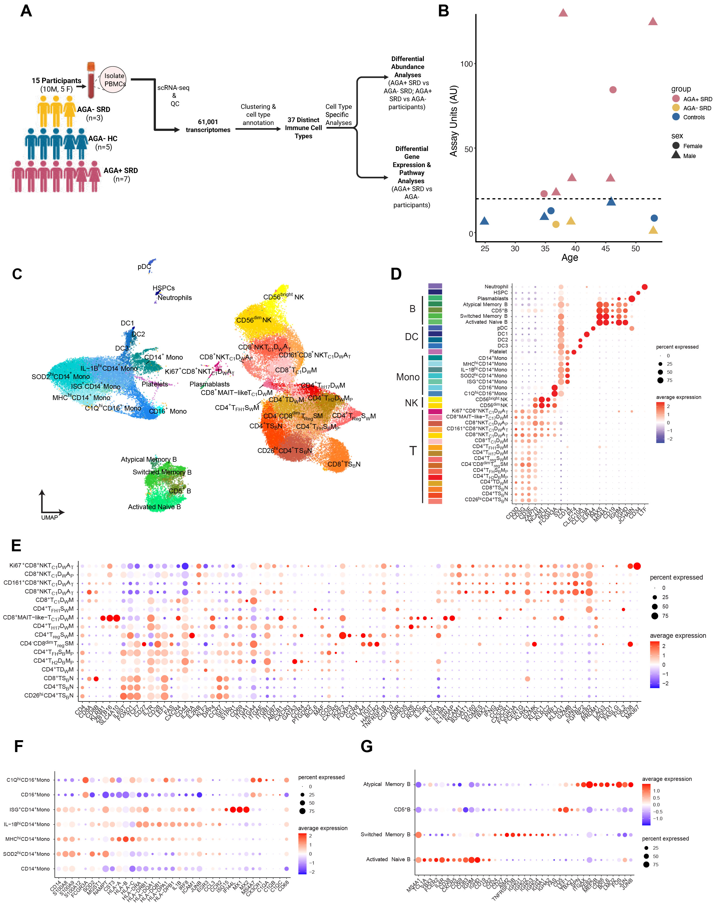
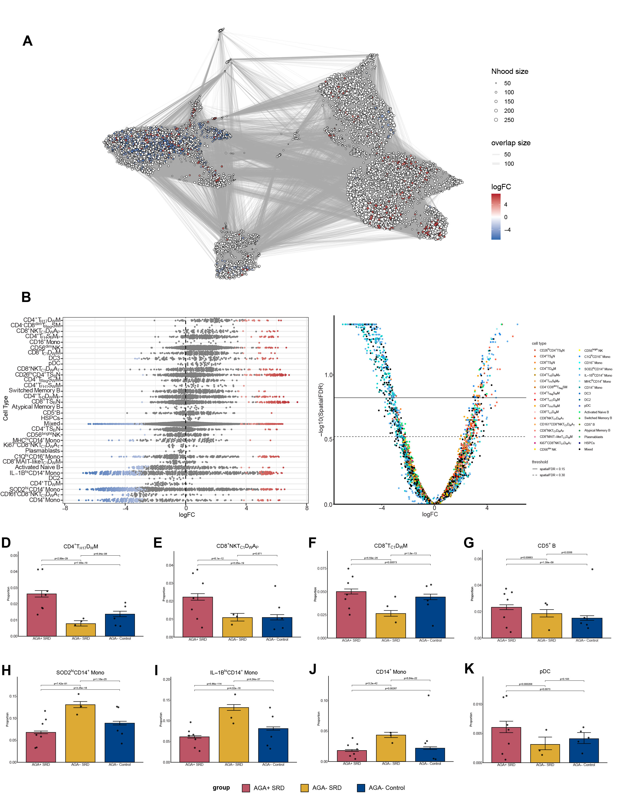
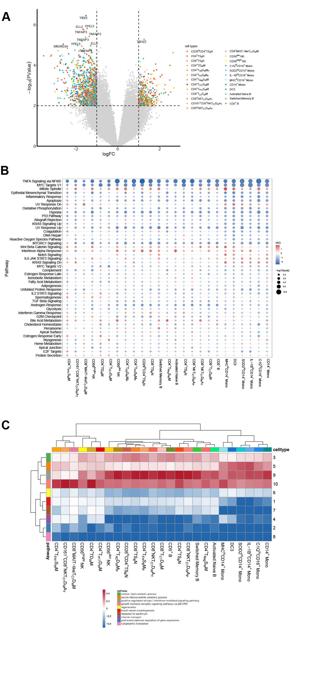
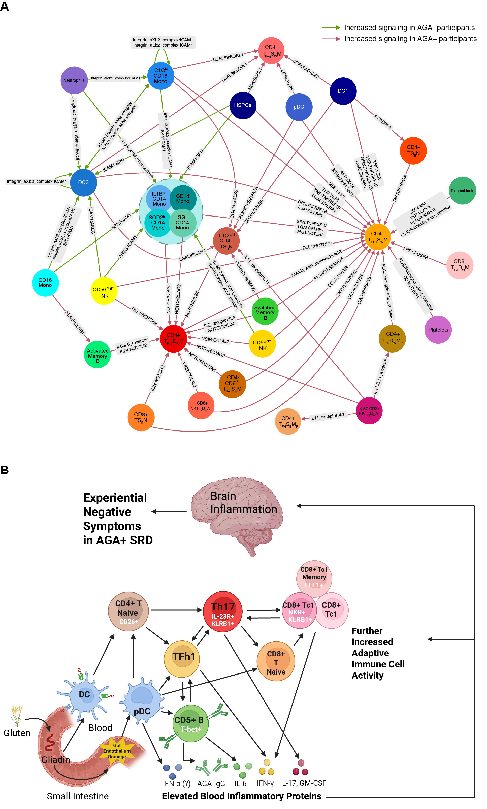

# Molecular adaptations of peripheral immune cells in an inflammation-associated schizophrenia subgroup
**Deepak Salem, Rowan K. O’Hara-Payne, Sarah M. Clark, Marcia Cortes-Gutierrez, Nevil J. Singh, Daniel J. Roche, Deanna L. Kelly, Seth A. Ament**

Thirty-five percent of people with schizophrenia-related disorders (SRD) form a high-inflammation subgroup defined by elevated anti-gliadin antibodies (AGA+) and inflammatory proteins and associated with an increased severity of negative symptoms. 
However, the immune mechanisms mediating these effects remain poorly defined. 
Here, we characterized transcriptional signatures of peripheral immune cells in AGA+ SRD (n=7) compared to AGA-negative (AGA-) SRD (n=3) and healthy controls (HCs; n=5), using single-cell RNA-sequencing (scRNA-seq) of peripheral blood mononuclear cells (PBMCs; n=61,001). 
AGA+ SRD was associated with increased abundance of T-helper-17 cells (Th17), T-follicular helper-1 (Tfh1), CD5+ B cells, plasmacytoid dendritic cells (pDCs), and several CD8+ T cell subsets, including memory and Natural Killer-T-like activated subsets. 
In contrast, AGA- SRD showed higher abundances of several monocyte subsets than either AGA+ SRD or HCs. 
Differential gene expression and pathway analyses identified altered metabolic and inflammatory signaling, including JAK/STAT, IL-6, WNT/β-catenin, and type I interferon-associated pathways across distinct immune cell populations. 
Cell-cell communication analysis further identified altered signaling between Th17 and myeloid populations, alongside differential myeloid signaling states and predicted LGALS9-mediated interactions between C1Qhi CD16+ monocytes and T cell populations in AGA+ SRD. 
Collectively, these results define a unique peripheral immune signature associated with AGA status in SRD, characterized by adaptive immune cell enrichment and altered immune cell communication in AGA+ SRD and a more prominent monocyte signature in AGA- SRD. 
These findings contribute to our current understanding of negative symptom-predominant, AGA+ SRD and highlight potential targets for therapeutic intervention for this subgroup.

Keywords: *schizophrenia*, *single cell*, *T cell*, *antigliadin antibody*, *RNA sequencing*, *inflammation*.

[Pre-print](https://www.biorxiv.org/content/10.64898/2026.05.22.727194v1)

## Scripts
1. [01-qc_and_preprocessing.R](scripts/01-qc_and_preprocessing.R)
2. [03-differential_abundance_milo.R](scripts/03-differential_abundance_milo.R)
3. [04-differential_abundance_model.R](scripts/04-differential_abundance_model.R)
4. [05-differential_gene_expression.R](scripts/05-differential_gene_expression.R)
5. [06-gene_set_enrichment_analysis.R](scripts/06-gene_set_enrichment_analysis.R)
6. [07-kmeans_clustering_degs.R](scripts/07-kmeans_clustering_degs.R)
7. [08-differential_signaling_domino.R](scripts/08-differential_signaling_domino.R)
8. [08.1-pySCENIC.sh](scripts/08.1-pySCENIC.sh)

## Plots

**Figure 1: Single-cell transcriptomic profiling of peripheral immune cells from schizophrenia subgroups.** A. Study design. B. AGA-IgG level, age, and sex for each study participant. Dashed line indicates AGA+ threshold of 20U. C. Uniform Manifold Approximation and Projection (UMAP) plot for scRNA-seq of peripheral blood mononuclear cells (PBMCs) clustered into 37 subpopulations. D-G. Dot plots showing marker genes for broad immune cell classes (D) T cell subpopulations (E),  monocyte subpopulations (F), and B cell subpopulations, excluding plasmablasts (G), with color bar indicating relative z-scored expression of each marker gene. 

**Figure 2: Differential abundance of immune subpopulations in SRD subgroups.** A. Graph-based representation of cell populations (neighborhoods) identified by Milo. Each node depicts a neighborhood, with differentially abundant neighborhoods (FDR < 30%) colored by their log fold change in AGA+ SRD vs. AGA- participants (AGA- SRD plus AGA- HC). The size of each node depicts the number of cells per neighborhood, and edges depict the number of cells shared between adjacent neighborhoods. B. Beeswarm plot showing the distribution of log fold change in abundance between conditions in neighborhoods annotated to each cell type. Positive log fold change indicates higher abundance in AGA+ SRD compared to AGA- participants. Differentially abundance neighborhoods (FDR < 30%) are colored. C. Volcano plot showing each neighborhood’s respective log fold change and -log10(FDR) between AGA+ SRD and AGA- participants, colored by cell type. Solid line indicates FDR < 15% and dashed line indicates FDR < 30%. D-K. Bar plots depicting the proportion of cells assigned to each differentially abundant cell type in AGA+ SRD (red), AGA- SRD (yellow), and HC (blue) participants.

**Figure 3: Differentially expressed genes and pathways in AGA+ SRD.** A. Volcano plot depicting the differential gene expression log fold change between AGA+ SRD and AGA- participants. Colored points indicate differentially expressed genes (DEGs) with log2 fold change > 1 and p-value < 0.01. DEGs that passed multiple testing corrections are labeled. B. Dot plot of normalized enrichment score (NES) from gene set enrichment analysis (GSEA). Dot size corresponds to the -log10(FDR-adjusted p-value) of each Molecular Signature Database (MSigDB) Hallmark pathway. Dot color corresponds to NES, with red indicating positive enrichment in AGA+ SRD, and dark blue indicating negative enrichment. C. Heatmap depicting the log2 fold changes of k-means clustering centroids in AGA+ SRD vs. AGA- participants across cell types. Rows are annotated with the most overrepresented Gene Ontology Biological Process for each module. Red = upregulated in AGA+ SRD. 

**Figure 4: Predicted cell-cell signaling alterations in AGA+ SRD.** A. Cell-cell signaling map of immune cell subsets in AGA+ participants AGA+ SRD vs. AGA- participants. Maroon arrows indicate increased signaling in AGA+ SRD; green arrows indicate increased signaling in AGA- participants. Ligand-receptor interactions are labeled on each arrow, with the expression of the ligand located on the cell type where the arrow is originating, and the receptor located on the cell type where the arrow is terminating. B. Conceptual overview of T cell predominant inflammation and potential mechanism in the pathogenesis of experiential negative symptoms in AGA+ SRD. Gluten ingestion and subsequent digestion in the small intestine gliadin elicits an inappropriate local inflammatory response that subsequently leads to systemic inflammation. Dendritic Cells (DCs), as primary antigen-presenting cells, present gliadin to B cells, which become activated and express CD5, subsequently gaining the ability to secrete AGA-IgG. In tandem, DCs present gliadin antigen to naïve CD4+ T cells, which differentiate into Tfh1 cells. Along with DCs, plasmacytoid dendritic cells (pDCs) sensing gut endothelium damage from gliadin-induced local inflammation activates these same adaptive immune cells. Tfh1 cells can provide help for the maturation of effector CD5+ B cells with upregulation of T-bet and IL-6 secretory function. Additionally, Tfh1 cells, along with higher IL-6 levels, can help differentiate Th17 cells by expressing pathogenic markers such as IL-23R and KLRB1. Th17 cells, through secretion of IL-17 and GM-CSF, can recruit and increase the cytotoxicity and effector potential of CD8+ T cells and can attract naïve CD8+ T cells, which with the help of pDCs, can also help with CD8+ T cell maturation into effector CD8+ T cells expressing Natural Killer Receptors, KLRB1, and stem-like markers including LEF1. Additionally, IL-17 secreted by Th17 cells can increase blood-brain permeability, allowing for easier brain migration of central nervous system (CNS) homing effector T cells that express ITGA4 and ITGB7, including the CD8+ T effector cells and pathogenic Th17 cells. IFN- ɣ secreted by effector CD8+ Tc1 cells, with GM-CSF and potentially Type 1 Interferons, can lead to more immune dysfunction contributing to CNS inflammation. With the increased brain inflammation in AGA+ SRD, central processes such as neurotransmitter changes and downstream functional connectivity changes downstream can contribute to the pathogenesis of experiential negative symptoms (anhedonia and motivational deficits) that are chronic in SRD.

## Supplemental Data
Also available an Excel spreadsheet with each data set as a separate tab.

1. [Differentially Expressed Genes](data/dge_pseudobulk_edgeR.txt)
   - Differential gene expression analysis results with p-value < 0.01
2. [Gene Set Enrichment Analysis of DEGs](data/gsea_results_all_hallmark.csv)
   - Gene Set Enrichment Analysis results with p-value < 0.05
3. [K-Means Clustering of DEGs](data/kmeans.k10.module_membership.txt)
   - K means clustering analysis results for each gene, including the each cluster's and cell type's expression of the gene
4. [Differential Signaling Linkages](data/sig_diff_linkages_all.csv)
   - Differential Signaling analysis results from DominoSignal with p < 0.05
5. [Incoming Ligand Senders](data/incoming_ligand_senders.csv)
   - Top three cell types expressing each ligand in a receptor-ligand pair
